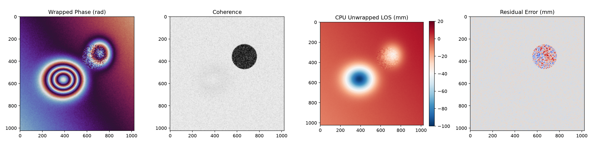

# insar-cpu-proto

This project is a high-performance, native C++20 InSAR (Interferometric Synthetic Aperture Radar) processing engine designed to convert satellite radar observations into millimeter-scale ground-deformation measurements at near real-time speeds. Its core goal is to replace slow, batch-oriented academic InSAR scripts with a memory-resident, GPU-accelerated computational engine capable of continuous, corridor- and country-scale infrastructure monitoring.



*Left to right: (1) wrapped $7\times 7$ interferometric phase $\psi \in [-\pi, \pi]$, (2) estimated coherence $\gamma \in [0, 1]$ showing the simulated decorrelated patch, (3) unwrapped line-of-sight (LOS) displacement in mm, and (4) residual error against synthetic ground truth after global offset alignment.*

---

## Why This Project Exists

Satellite radar coverage has expanded sharply in 2026. ESA's Sentinel-1D opened user data in April 2026 and became fully operational in May 2026, orbiting 180° apart in tandem with Sentinel-1C for rapid global C-band revisits. Alongside it, the NASA–ISRO NISAR mission was declared fully operational in January 2026, delivering open L-band and S-band SAR imagery on a 12-day exact repeat cycle that penetrates vegetation canopies where C-band radar loses coherence.

Despite this surge in free, high-cadence radar data, most operational InSAR pipelines still rely on legacy CPU tools (such as SNAP, SNAPHU, StaMPS, and MintPy) stitched together with Python wrappers and intermediate disk files. Those stacks frequently take 30–60 minutes to unwrap a single swath and reprocess entire historical stacks whenever a new satellite pass arrives—making continuous monitoring across national rail networks, pipelines, water utilities, or mines prohibitively slow and expensive.

---

## Technical Approach & What v0.1 Implements

The v0.1 prototype validates the core mathematical and systems foundation: fusing interferogram formation, coherence estimation, and coherence-weighted 2D phase unwrapping inside persistent memory buffers without intermediate disk I/O. It currently exists in two mathematically identical backends:

- **Local CPU Prototype ([`src/insar_engine_cpu.cpp`](src/insar_engine_cpu.cpp)):** A zero-dependency C++20 + OpenMP implementation featuring a built-in, cache-blocked, multithreaded 2D radix-2 FFT. It runs locally on any standard laptop or workstation to verify millimeter-level accuracy and establish a clean CPU runtime baseline.
- **GPU Prototype (`insar_engine.cu`):** A C++20 + CUDA / cuFFT implementation that keeps complex radar tiles, coherence weights, and iterative solver vectors resident in GPU VRAM to eliminate PCIe and storage bottlenecks.

### Core Pipeline Inside v0.1

- **Fused Interferogram & Coherence Estimation:** Computes complex cross-multiplication ($S_1 \cdot S_2^*$), wrapped interferometric phase, and $7 \times 7$ spatial coherence in a single memory pass.
- **Coherence-Weighted PCG Phase Unwrapping:** Solves the weighted least-squares phase unwrapping problem using Preconditioned Conjugate Gradient (PCG), preconditioned by an exact half-sample mirrored 2D FFT Neumann Poisson solver. Edge weights scale cubically with coherence ($\gamma^3$), routing phase integration around decorrelated regions (such as water bodies or dense forests) so noise does not corrupt nearby subsidence signals.
- **Verification & Visualization Harness:** Includes a built-in Sentinel-1 C-band synthetic radar generator (complete with circular complex Gaussian speckle, multi-fringe subsidence bowls, and a decorrelated lake/forest patch), raw complex float32 file hooks (`--slc1`, `--slc2`), automatic line-of-sight RMSE calculation in millimeters, and a Python plotting utility ([`scripts/inspect_output.py`](scripts/inspect_output.py)).

---

## Prototype vs. Production Engine Scope

| Capability | Current v0.1 Prototype | Target Commercial Engine |
| :--- | :--- | :--- |
| **Compute Backends** | Standalone C++20/OpenMP CPU and CUDA/cuFFT GPU | Unified backend abstraction with out-of-core VRAM tiling (full 250 km swaths in 8 GB VRAM) |
| **Data Ingestion** | Built-in synthetic C-band generator + raw binary complex float32 | Native GDAL/HDF5 streaming for Sentinel-1 IW SLC, NISAR L-band, and commercial X-band (ICEYE, Capella, Umbra) |
| **Preprocessing** | Assumes pre-coregistered complex pairs | GPU Range-Doppler coregistration, Enhanced Spectral Diversity (ESD), and baseline-version guardrails |
| **Denoising** | $7 \times 7$ boxcar multilooking | Adaptive Goldstein or tiled nonlocal InSAR-BM3D filtering to preserve sharp fringe gradients |
| **Time Series** | Single interferometric pair | Sequential (online) PS/DS updating ($O(1)$ append per new satellite pass) + ascending/descending vertical-vs-horizontal decomposition |
| **Outputs** | Binary `.f32` rasters + terminal benchmark metrics | Cloud-native GeoParquet / PostGIS feeds and automated velocity-acceleration alerts pinned to vector assets |

---

## Commercial Vision

Because the engine's moat lies in compute efficiency, multi-sensor fusion (C-band + L-band), and incremental time-series updating, it supports two distinct go-to-market models:

- **OEM Engine / API Licensing:** Licensing the C++/GPU binary or cloud API to commercial SAR constellation operators, geotechnical consultancies, and infrastructure insurers who want to power continuous subsidence monitoring without building an internal HPC radar team.
- **Vertical Linear-Asset Monitoring SaaS:** Focusing on a high-liability vertical—such as mining tailings dams, rail embankments, or buried water and gas networks—to act as a continuous, network-wide early-warning triage layer that flags sudden ground-movement acceleration for field engineers.

---

## Mathematical Formulation

### 1. Interferogram & Coherence Estimation

Given two co-registered Single Look Complex (SLC) images $s_1, s_2 \in \mathbb{C}^{H \times W}$ and a $(2r+1)\times(2r+1)$ boxcar window $\mathcal{N}_r(x,y)$ (default $r=3$, i.e., $7\times 7$), the multi-looked complex interferogram is:

$$
C(x, y) = \sum_{(i, j) \in \mathcal{N}_r(x, y)} s_1(i, j)\, s_2^*(i, j)
$$

The **wrapped interferometric phase** $\psi(x, y)$ and **sample coherence magnitude** $\gamma(x, y)$ are:

$$
\psi(x, y) = \operatorname{atan2}\!\big(\operatorname{Im}\, C(x, y),\; \operatorname{Re}\, C(x, y)\big) \in [-\pi, \pi]
$$

$$
\gamma(x, y) = \operatorname{clip}\!\left(
\frac{|C(x, y)|}{\sqrt{\left(\sum_{\mathcal{N}_r} |s_1|^2\right)\left(\sum_{\mathcal{N}_r} |s_2|^2\right)} + \varepsilon},\; 0,\; 1
\right), \quad \varepsilon = 10^{-12}
$$

---

### 2. Coherence-Weighted Least-Squares Phase Unwrapping

On the 4-connected pixel grid, define edge weights and wrapped forward phase differences with $w_{\min} = 10^{-4}$:

$$
w_x(x, y) = \max\!\Big(w_{\min},\; \min\big(\gamma(x, y),\, \gamma(x+1, y)\big)^3\Big), \qquad
\Delta_x(x, y) = \mathcal{W}\!\big(\psi(x+1, y) - \psi(x, y)\big)
$$

$$
w_y(x, y) = \max\!\Big(w_{\min},\; \min\big(\gamma(x, y),\, \gamma(x, y+1)\big)^3\Big), \qquad
\Delta_y(x, y) = \mathcal{W}\!\big(\psi(x, y+1) - \psi(x, y)\big)
$$

where the wrapping operator maps phase differences onto $[-\pi, \pi)$:

$$
\mathcal{W}(d) = \big((d + \pi) \bmod 2\pi\big) - \pi
$$

Phase unwrapping finds $\phi \in \mathbb{R}^{H \times W}$ minimizing the weighted gradient mismatch:

$$
\min_{\phi}\; \frac{1}{2} \sum_{y=0}^{H-1} \sum_{x=0}^{W-2} w_x(x, y)\big(\phi(x+1, y) - \phi(x, y) - \Delta_x(x, y)\big)^2
+ \frac{1}{2} \sum_{y=0}^{H-2} \sum_{x=0}^{W-1} w_y(x, y)\big(\phi(x, y+1) - \phi(x, y) - \Delta_y(x, y)\big)^2
$$

Setting $\nabla_\phi J = 0$ yields the symmetric positive semi-definite linear system $L_w \phi = b$:

$$
\begin{aligned}
\big(L_w \phi\big)(x, y) =\;& w_x(x, y)\big(\phi(x, y) - \phi(x+1, y)\big) + w_x(x-1, y)\big(\phi(x, y) - \phi(x-1, y)\big) \\
+\;& w_y(x, y)\big(\phi(x, y) - \phi(x, y+1)\big) + w_y(x, y-1)\big(\phi(x, y) - \phi(x, y-1)\big)
\end{aligned}
$$

$$
b(x, y) = \big(w_x(x-1, y)\,\Delta_x(x-1, y) - w_x(x, y)\,\Delta_x(x, y)\big)
        + \big(w_y(x, y-1)\,\Delta_y(x, y-1) - w_y(x, y)\,\Delta_y(x, y)\big)
$$

with out-of-bounds edge weights set to $0$ (homogeneous Neumann boundary conditions).

---

### 3. Exact Neumann Poisson Preconditioner via Mirrored 2D FFT

The system $L_w \phi = b$ is solved with **Preconditioned Conjugate Gradient (PCG)** using the unweighted 2D discrete Neumann Laplacian $L$ as preconditioner ($M^{-1} r = L^+ r$).

To enforce homogeneous Neumann boundaries exactly with a radix-2 FFT, the residual $r \in \mathbb{R}^{H \times W}$ is half-sample mirror-padded to size $M_H \times M_W = 2H \times 2W$:

$$
\tilde{r}(x, y) = \tilde{r}(2W - 1 - x, y) = \tilde{r}(x, 2H - 1 - y) = \tilde{r}(2W - 1 - x, 2H - 1 - y) = r(x, y)
$$

for $0 \le x < W,\; 0 \le y < H$. Taking the 2D DFT $\widehat{R} = \mathcal{F}_{2\text{D}}\{\tilde{r}\}$ diagonalizes the discrete 5-point Neumann Laplacian, giving the spectral divide:

$$
\widehat{Z}(k_x, k_y) =
\begin{cases}
0, & k_x = 0 \text{ and } k_y = 0 \\[6pt]
\dfrac{\widehat{R}(k_x, k_y)}{4 - 2\cos\!\left(\dfrac{\pi k_x}{W}\right) - 2\cos\!\left(\dfrac{\pi k_y}{H}\right)}, & \text{otherwise}
\end{cases}
$$

The preconditioned vector $z$ is obtained by taking the real part of the top-left $H \times W$ quadrant of $\frac{1}{M_W M_H}\,\mathcal{F}_{2\text{D}}^{-1}\{\widehat{Z}\}$.

---

### 4. Phase-to-LOS Conversion & Synthetic Test Scene

For Sentinel-1 C-band ($\lambda = 55.4658\text{ mm}$), two-way line-of-sight displacement $d_{\text{LOS}}$ relates to interferometric phase $\phi$ by:

$$
\phi = \frac{4\pi}{\lambda}\, d_{\text{LOS}}, \qquad d_{\text{LOS}} = \frac{\lambda}{4\pi}\, \phi
$$

where one full $2\pi$ fringe corresponds to $\lambda / 2 \approx 27.73\text{ mm}$ of LOS motion.

In normalized coordinates $x_n = x/W - 0.5,\; y_n = y/H - 0.5$, the built-in synthetic scene generates:

$$
d_{\text{LOS}}(x_n, y_n) = -95\, e^{-r_1} - 40\, e^{-r_2} + 12\, x_n - 8\, y_n \quad [\text{mm}]
$$

$$
r_1 = \frac{(x_n + 0.12)^2}{0.018} + \frac{(y_n - 0.05)^2}{0.014}, \qquad
r_2 = \frac{(x_n - 0.20)^2}{0.008} + \frac{(y_n + 0.18)^2}{0.010}
$$

with a simulated decorrelated region where true coherence $\rho = 0.15$ inside $\frac{(x_n - 0.15)^2 + (y_n + 0.15)^2}{0.012} < 1$ and $\rho = 0.90$ elsewhere:

$$
s_1 = a_{\text{re}} + i\, a_{\text{im}}, \qquad
s_2 = \rho\, s_1 e^{-i\phi} + \sqrt{1 - \rho^2}\,(n_{\text{re}} + i\, n_{\text{im}}), \qquad
a_{\text{re}}, a_{\text{im}}, n_{\text{re}}, n_{\text{im}} \sim \mathcal{N}(0, 1)
$$

---

## Build & Run

```bash
cmake -B build
cmake --build build
./build/insar_proto --dump
python3 scripts/inspect_output.py
```

### CLI Options

- `--width <N>` / `--height <N>`: Raster dimensions (must be powers of 2; default `1024 x 1024`)
- `--iters <N>`: Maximum PCG iterations (default `35`, tolerance `1e-4`)
- `--slc1 <path>` / `--slc2 <path>`: Optional raw `complex<float>` (`complex64`) binary SLC inputs
- `--dump`: Write `wrapped_phase.f32`, `coherence.f32`, `unwrapped_phase.f32` (and `true_phase.f32` for synthetic runs)
