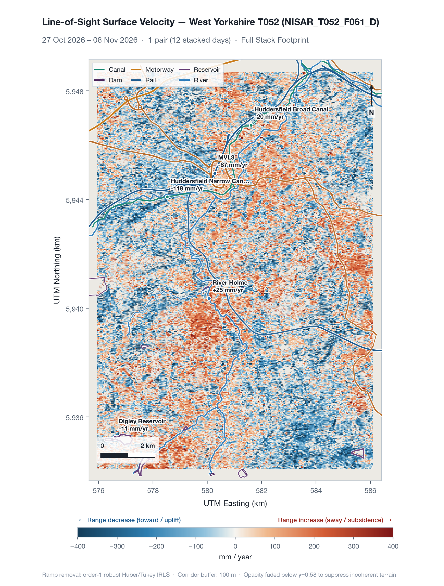

# insar-cpu-proto

Native C++20 + OpenMP InSAR processing and sequential $O(1)$ time-series stacking engine for Sentinel-1 (OPERA CSLC-S1) and NISAR (L-band GSLC) radar imagery. Converts coregistered complex pairs into millimeter-scale line-of-sight (LOS) deformation rasters, Cloud-Optimized GeoTIFFs, and linear infrastructure corridor risk alerts.

---

## Outputs

### Mexico City — Sentinel-1 C-Band Sequential Stack (`T041_086877_IW1`)


*24 consecutive OPERA CSLC-S1 pairs (19 Jun – 17 Nov 2026, 145 stacked days), order-1 coherence-weighted Huber IRLS ramp removal, coherence-modulated shading, and 100 m buffered Metro, Rail, and Motorway corridor overlays.*

### West Yorkshire — NISAR L-Band (`NISAR_T052_F061_D`)

<p align="center">
  
</p>

*12-day L-band NISAR GSLC pair (27 Oct – 08 Nov 2026) over Huddersfield and the Holme Valley with buffered Canal, Rail, Motorway, River, Dam, and Reservoir corridors.*

### Single-Pair Diagnostics (`insar_proto`)


*Pair-level outputs for `NISAR_T052_F061_D_2026-10-27_2026-11-08`: wrapped interferometric phase $\psi \in [-\pi, \pi]$, spatial coherence $\gamma \in [0, 1]$, and unwrapped LOS displacement (mm) with high-coherence anomaly alerts.*

---

## Architecture

| Component | Path | Role |
| :--- | :--- | :--- |
| **Pair Engine** | [`src/engine/`](src/engine) · `insar_proto` | Fused boxcar interferogram & coherence, $\gamma^3$-weighted PCG phase unwrapping with exact mirrored-2D-FFT Neumann preconditioner, COG + STAC + alert export |
| **Online Stacker** | [`src/insar_stack_cpu.cpp`](src/insar_stack_cpu.cpp) · `insar_stack` | $O(1)$ per-pass updates to a 13-band Float64 sufficient-statistics raster (`stack_state.tif`), Huber IRLS ramp removal, velocity/uncertainty/acceleration COGs, buffered corridor risk analytics |
| **Ingestion** | [`scripts/auto_ingest.py`](scripts/auto_ingest.py) | Automated Sentinel-1 OPERA & NISAR L-band discovery, SQLite state tracking, and pair execution |
| **Stack Runner** | [`scripts/stack_timeseries.py`](scripts/stack_timeseries.py) | Chronological pair-chain discovery, incremental `insar_stack` dispatch, ledger & corridor timeseries management |
| **Cartography** | [`scripts/plots/plot_raster_map.py`](scripts/plots/plot_raster_map.py) | Standalone publication maps for `velocity`, `cumulative`, `coherence`, `uncertainty`, and `acceleration` layers |
| **HTTP API** | [`api/server.py`](api/server.py) | FastAPI asynchronous job runner and artifact server wrapping `insar_proto` |

---

## Quickstart

**Prerequisites:** CMake $\ge$ 3.18, a C++20 compiler (OpenMP optional), GDAL, and Python 3 with `numpy`, `matplotlib`, and `osgeo` for plotting.

```bash
# Build C++ binaries and tests
cmake -B build
cmake --build build -j
ctest --test-dir build --output-on-failure
```

```bash
# 1. Run a synthetic or real interferometric pair -> COGs + alerts.geojson
./build/insar_proto --out-dir out_synth
./build/insar_proto --slc1 ref.h5 --slc2 sec.h5 --out-dir out_pair

# 2. Incrementally update a multi-pass stack + corridor analytics
python3 scripts/stack_timeseries.py \
  --products-dir insar_work/products \
  --out-dir insar_work/stacks/mexico_city_iw1 \
  --corridors data/corridors/mexico_city_corridors.geojson

# 3. Render a cartographic raster map
python3 scripts/plots/plot_raster_map.py \
  --stack-dir insar_work/stacks/mexico_city_iw1 \
  --layer velocity
```

---

<details>
<summary><strong>Method & Mathematical Summary</strong></summary>

1. **Interferogram & Coherence:** For coregistered SLCs $s_1, s_2$ over a $(2r_x+1)\times(2r_y+1)$ window $\mathcal{N}$, $C = \sum_{\mathcal{N}} s_1 s_2^*$, wrapped phase $\psi = \operatorname{atan2}(\operatorname{Im} C, \operatorname{Re} C)$, and coherence $\gamma = |C| / \big(\sqrt{\sum_{\mathcal{N}} |s_1|^2 \sum_{\mathcal{N}} |s_2|^2} + \varepsilon\big)$.
2. **Coherence-Weighted Unwrapping:** Minimizes $\frac{1}{2}\sum_e w_e (\nabla_e \phi - \mathcal{W}(\nabla_e \psi))^2$ with cubic edge weights $w_e = \max(10^{-4}, \min(\gamma_u, \gamma_v)^3)$ via Preconditioned Conjugate Gradient (PCG), preconditioned by an exact half-sample mirrored 2D radix-2 FFT Neumann Poisson solver.
3. **LOS Displacement:** $d_{\text{LOS}} = \frac{\lambda}{4\pi}\phi$, parameterized per sensor ($\lambda = 55.4658\text{ mm}$ for Sentinel-1 C-band; dynamic HDF5 wavelength $\approx 238.4\text{ mm}$ for NISAR L-band).
4. **Sequential $O(1)$ Stacking:** After order-$k$ coherence-weighted Huber IRLS ramp removal, each new interferogram updates a persistent 13-band Float64 normal-equation state (`stack_state.tif`) in constant time per pass, yielding exact least-squares velocity, velocity standard error, acceleration, cumulative displacement, and temporal coherence without reprocessing history.

</details>
