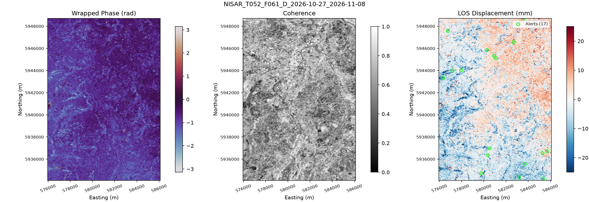

# insar-cpu-proto

Native C++20 + OpenMP InSAR processing and sequential $O(1)$ time-series stacking engine for Sentinel-1 (OPERA CSLC-S1) and NISAR (L-band GSLC) radar imagery. Converts coregistered complex SLC pairs into calibrated millimeter-scale line-of-sight (LOS) deformation rasters, Cloud-Optimized GeoTIFFs, STAC 1.1.0 items, and SNR/maturity-gated linear infrastructure corridor risk alerts.

---

## Ground-Truth GNSS Validation — Mexico City (`T041_086877_IW1`)

<p align="center">
  
  
  
</p>

*Independent validation of a 24-pair Sentinel-1 OPERA CSLC-S1 stack (19 Jun – 17 Nov 2026, 145 stacked days) against 6 Nevada Geodetic Laboratory (UNR) North-America-fixed GNSS stations projected onto exact Sentinel-1 zero-Doppler LOS vectors (from OPERA ECEF orbit state vectors). Full per-station tables: [`data/validation/mexico_city_gnss_validation.json`](data/validation/mexico_city_gnss_validation.json) · [`mexico_city_gnss_validation.csv`](data/validation/mexico_city_gnss_validation.csv).*

| Pipeline Configuration | RMSE (mm/yr) | MAE (mm/yr) | Bias (mm/yr) | $R^2$ | Pearson $r$ | `MMX1` (2026 overlap, −215.0 mm/yr GNSS) |
| :--- | :---: | :---: | :---: | :---: | :---: | :---: |
| Baseline (whole-scene median, unmasked order-1 ramp, no DEM) | 64.0 | 42.5 | +37.8 | 0.321 | 0.883 | −70.3 mm/yr (err +144.7) |
| + Bedrock reference pin (`-99.215, 19.420`, $r = 1\text{ km}$, order-0) | 34.6 | 31.2 | −12.2 | 0.802 | 0.932 | −234.5 mm/yr (err −19.5) |
| **+ Copernicus GLO-30 DEM tropo + 2-pass deformation masking** | **18.3** | **15.1** | **−3.0** | **0.945** | **0.973** | **−213.3 mm/yr (err +1.7)** |

- **71.5% RMSE reduction** (64.0 → **18.3 mm/yr**) and **$R^2 = 0.945$** across all 6 independent stations (the bedrock reference pin in Lomas de Chapultepec is distinct from all validation stations).
- **Live 2026 cumulative overlay at `MMX1` (Mexico City Airport):** **7.7 mm** epoch-to-epoch RMSE across 25 Sentinel-1 passes against 142 daily UNR IGS20 GNSS observations tracking −85 mm of active clay-basin subsidence.

---

## Outputs

### Mexico City — Sentinel-1 C-Band Sequential Stack (`T041_086877_IW1`)


*24 consecutive OPERA CSLC-S1 pairs (19 Jun – 17 Nov 2026, 145 stacked days), connected-component bedrock reference pinning, two-pass adaptive high-deformation masking, Copernicus GLO-30 DEM tropospheric regression, coherence-modulated shading, and 100 m buffered Metro, Rail, and Motorway corridor overlays with $|v|/\sigma_v \ge 2.5$ SNR gating (suppressing false-positive critical alerts across incoherent mountain unwrapping boundaries while preserving true clay-basin alerts on Línea VK, Línea A, Línea B, and Circuito Interior).*

### West Yorkshire — NISAR L-Band (`NISAR_T052_F061_D`)

<p align="center">
  
</p>

*12-day L-band NISAR GSLC pair (27 Oct – 08 Nov 2026) over Huddersfield and the Holme Valley with buffered Canal, Rail, Motorway, River, Dam, and Reservoir corridors.*

### Single-Pair Diagnostics (`insar_proto`)



*Pair-level outputs for `NISAR_T052_F061_D_2026-10-27_2026-11-08`: wrapped interferometric phase $\psi \in [-\pi, \pi]$, spatial coherence $\gamma \in [0, 1]$, and unwrapped LOS displacement (mm) with high-coherence anomaly alerts.*

---

## Architecture

| Component | Path | Role |
| :--- | :--- | :--- |
| **Pair Engine** | [`src/engine/`](src/engine) · `insar_proto` | Coregistered OPERA CSLC-S1 / NISAR GSLC / GeoTIFF ingestion, fused boxcar interferogram & coherence, $\gamma^3$-weighted PCG phase unwrapping with exact mirrored-2D-FFT Neumann preconditioner, stable reference region pinning (`--ref-lonlat` / `--ref-px`), COG + STAC + GeoJSON alert export |
| **Online Stacker** | [`src/insar_stack_cpu.cpp`](src/insar_stack_cpu.cpp) · `insar_stack` | $O(1)$ per-pass updates to a 13-band Float64 sufficient-statistics raster (`stack_state.tif`), connected-component reference pinning, explicit/two-pass high-deformation masking, joint robust polynomial + DEM tropospheric regression (`--dem`), skip-1/skip-2 triplet phase closure masking & corrupted-pair rejection, velocity/uncertainty/SNR/acceleration COGs, and SNR + stack-maturity gated corridor risk analytics |
| **Ingestion** | [`scripts/auto_ingest.py`](scripts/auto_ingest.py) | Automated Sentinel-1 OPERA & NISAR L-band discovery, `--max-skip {0,1,2}` redundant pair network generation, SQLite state tracking, and dispatch to `insar_proto` + `insar_stack` |
| **Stack Runner** | [`scripts/stack_timeseries.py`](scripts/stack_timeseries.py) | Chronological + skip-pair network discovery, automatic closure triplet assembly, two-pass high-deformation masking, and incremental `insar_stack` dispatch |
| **DEM & GNSS Validation** | [`scripts/fetch_dem.py`](scripts/fetch_dem.py) · [`scripts/validate_gnss.py`](scripts/validate_gnss.py) | Copernicus GLO-30 COG tile fetch/alignment and UNR/NGL GNSS LOS ground-truth validation with exact zero-Doppler orbit projection and standalone map, scatter, and time-series figures |
| **Cartography** | [`scripts/plots/plot_raster_map.py`](scripts/plots/plot_raster_map.py) | Standalone publication maps for `velocity`, `cumulative`, `coherence`, `uncertainty`, and `acceleration` layers |
| **Unified OEM API & Docker** | [`api/server.py`](api/server.py) · [`Dockerfile`](Dockerfile) · [`sdk/demo_client.py`](sdk/demo_client.py) | FastAPI service unifying `insar_proto` (`/v1/jobs`) and `insar_stack` (`/v1/stacks/{stack_id}/updates`, `/v1/stacks`), STAC 1.1.0 pair & stack items, Range-streamable COGs, `/health`, and HMAC-SHA256 webhooks; multi-stage Docker container bundling both C++ binaries |

---

## Quickstart

**Prerequisites:** CMake $\ge$ 3.18, a C++20 compiler (OpenMP optional), GDAL, and Python 3 (`fastapi`, `uvicorn`, `httpx`, `pydantic` for the API; `numpy`, `matplotlib`, and `osgeo` for plotting & GNSS validation).

```bash
# Build C++ binaries (`insar_proto`, `insar_stack`) and run C++ + Python test suites
cmake -B build
cmake --build build -j
ctest --test-dir build --output-on-failure
python3 -m unittest discover -s tests -v
```

```bash
# 1. Run an interferometric pair with stable bedrock reference pinning -> COGs + alerts.geojson
./build/insar_proto \
  --slc1 ref.h5 --slc2 sec.h5 \
  --ref-lonlat -99.215 19.420 --ref-radius-m 1000 \
  --out-dir out_pair

# 2. Fetch and align Copernicus GLO-30 DEM to the InSAR stack grid
python3 scripts/fetch_dem.py \
  --target-raster out_pair/displacement_mm.tif \
  --out insar_work/dem/site_cop30.tif

# 3. Incrementally update a multi-pass stack (DEM tropo + reference pin + 2-pass deform mask
#    + automatic triplet closure when skip-1/skip-2 pairs exist + SNR/maturity corridor gating)
python3 scripts/stack_timeseries.py \
  --products-dir insar_work/products/mexico_city_iw1 \
  --out-dir insar_work/stacks/mexico_city_iw1 \
  --dem insar_work/dem/mexico_city_iw1_cop30.tif \
  --ref-lonlat -99.215 19.420 --ref-radius-m 1000 \
  --ramp-order 0 --two-pass-deform-mask \
  --corridors data/corridors/mexico_city_corridors.geojson \
  --min-alert-snr 2.5 --min-alert-span-days 60

# 4. Validate against UNR/NGL GNSS stations and render standalone benchmark figures
python3 scripts/validate_gnss.py \
  --stack-dir insar_work/stacks/mexico_city_iw1 \
  --products-dir insar_work/products/mexico_city_iw1 \
  --dem insar_work/dem/mexico_city_iw1_cop30.tif \
  --slc-h5 insar_work/raw/mexico_city_iw1 \
  --out-json data/validation/mexico_city_gnss_validation.json \
  --map-out docs/figures/mexico_city_gnss_map.png \
  --scatter-out docs/figures/mexico_city_gnss_scatter.png \
  --timeseries-out docs/figures/mexico_city_gnss_timeseries.png

# 5. Render a standalone cartographic velocity map
python3 scripts/plots/plot_raster_map.py \
  --stack-dir insar_work/stacks/mexico_city_iw1 \
  --layer velocity --focus-urban
```

### Unified OEM HTTP API & Docker

```bash
# Run locally (serves both /v1/jobs via insar_proto and /v1/stacks/{stack_id}/updates via insar_stack)
uvicorn api.server:app --host 0.0.0.0 --port 8000

# Or build & run the multi-stage container (bundles insar_proto, insar_stack, API, and scripts)
docker build -t insar-oem-api .
docker run -p 8000:8000 -v $(pwd)/data:/data insar-oem-api
```

Key endpoints: `GET /health`, `POST /v1/jobs`, `GET /v1/jobs/{job_id}`, `GET /stac/items/{job_id}`, `POST /v1/stacks/{stack_id}/updates`, `GET /v1/stacks`, `GET /v1/stacks/{stack_id}`, `GET /stac/stacks/{stack_id}`, `GET /assets/{job_id}/{file}`, `GET /stack-assets/{stack_id}/{file}`.

---

<details>
<summary><strong>Method & Mathematical Summary</strong></summary>

1. **Interferogram & Coherence:** For coregistered SLCs $s_1, s_2$ over a $(2r_x+1)\times(2r_y+1)$ window $\mathcal{N}$, $C = \sum_{\mathcal{N}} s_1 s_2^*$, wrapped phase $\psi = \operatorname{atan2}(\operatorname{Im} C, \operatorname{Re} C)$, and coherence $\gamma = |C| / \big(\sqrt{\sum_{\mathcal{N}} |s_1|^2 \sum_{\mathcal{N}} |s_2|^2} + \varepsilon\big)$.
2. **Coherence-Weighted Unwrapping:** Minimizes $\frac{1}{2}\sum_e w_e (\nabla_e \phi - \mathcal{W}(\nabla_e \psi))^2$ with cubic edge weights $w_e = \max(10^{-4}, \min(\gamma_u, \gamma_v)^3)$ via Preconditioned Conjugate Gradient (PCG), preconditioned by an exact half-sample mirrored 2D radix-2 FFT Neumann Poisson solver.
3. **LOS Displacement & Reference Pinning:** $d_{\text{LOS}} = \frac{\lambda}{4\pi}\phi$ ($\lambda = 55.4658\text{ mm}$ for Sentinel-1 C-band; dynamic HDF5 wavelength $\approx 238.4\text{ mm}$ for NISAR L-band), zero-referenced to the coherence-weighted median of a user-specified stable reference disk (`--ref-lonlat` / `--ref-px`) or GeoJSON/raster mask (`--ref-region`) rather than the whole-scene median.
4. **Connected-Component Isolation, High-Deformation Masking & DEM Tropospheric Correction:** Before fitting orbital/tropospheric nuisance terms, `insar_stack` restricts regression to the 4-connected coherent component anchored at the reference region (preventing cross-barrier $2\pi$ unwrapping jumps from leaking into regression) and masks active deformation zones via explicit polygons/rasters (`--deform-mask`), prior velocity (`--prior-vel` / `--two-pass-deform-mask`), and adaptive quantile capping. It jointly solves for a polynomial ramp plus ridge-damped elevation-correlated tropospheric delay $d_{\text{nuisance}}(x,y,z) = p_k(x,y) + \alpha\,\Delta z_{\text{km}}$ via Huber/Tukey IRLS, then re-pins the reference region to $0\text{ mm}$.
5. **Redundant Skip-1/Skip-2 Triplet Phase Closure:** When skip-1/skip-2 interferograms are available (`--max-skip 1|2`), `stack_timeseries.py` automatically supplies triangle loops to `insar_stack` to evaluate closure residuals $c = d_{AB} + d_{BC} - d_{AC}$ (datum-centered). Pixels exceeding `--closure-thresh-mm` (default $10\text{ mm}$) across a majority of triplets are masked before state updates, and pairs exceeding `--closure-max-bad-frac` (default $35\%$) are rejected cleanly before mutating `stack_state.tif`.
6. **Sequential $O(1)$ Stacking & SNR/Maturity-Gated Corridor Alerts:** Each accepted interferogram updates a persistent 13-band Float64 normal-equation state (`stack_state.tif`) in constant time per pass, producing exact WLS velocity $v$, standard error $\sigma_v$, signal-to-noise ratio $\text{SNR} = |v|/\sigma_v$ (`velocity_snr.tif`), acceleration, cumulative displacement, and temporal coherence. Critical corridor alerts require both sufficient velocity SNR ($|v|/\sigma_v \ge 2.5$) and minimum stack temporal maturity ($\ge 60\text{–}90\text{ days}$); immature stacks downgrade critical alerts to provisional warnings.

</details>
