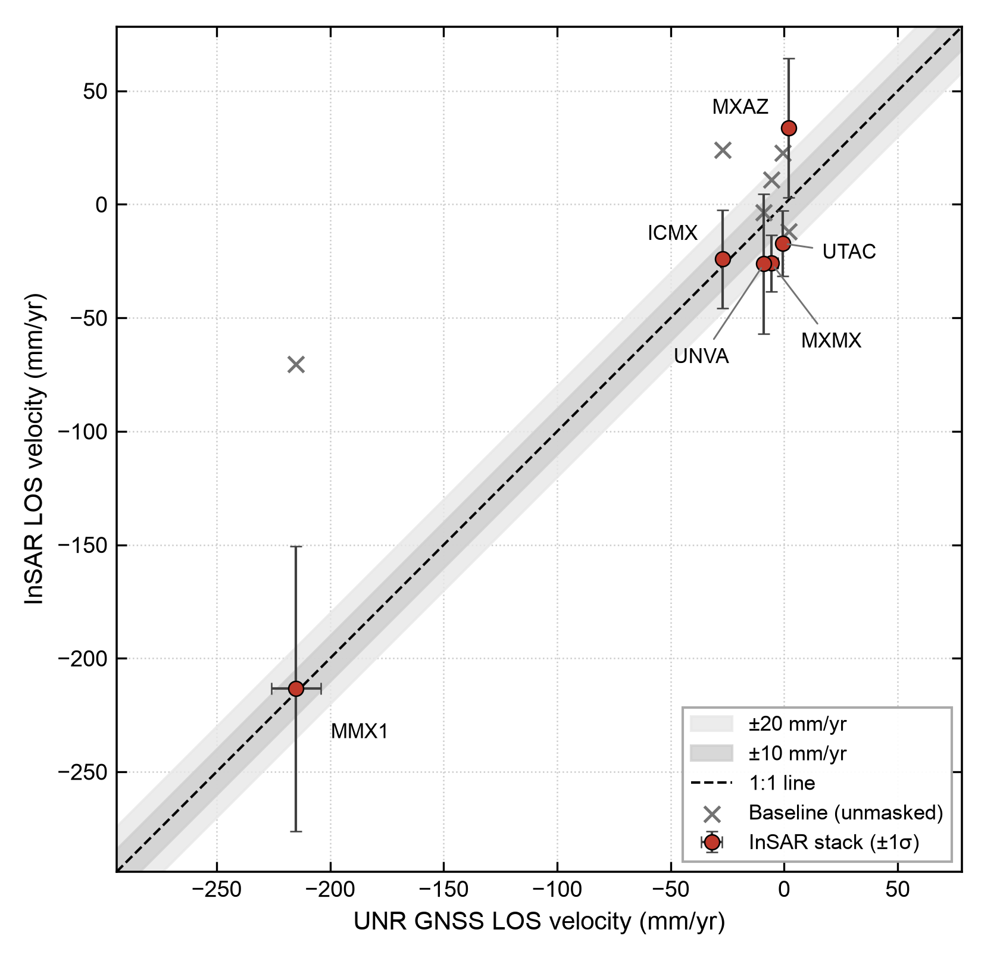
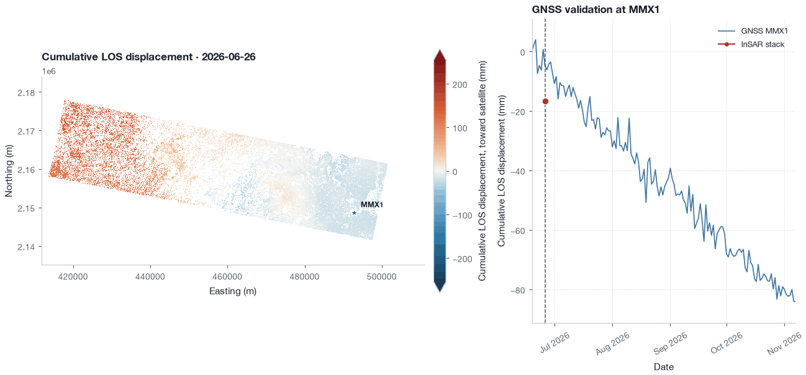
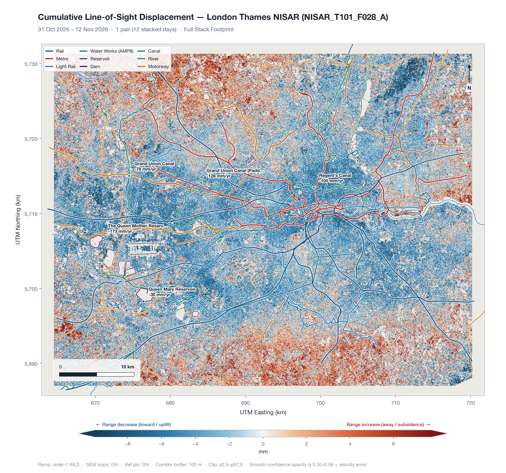
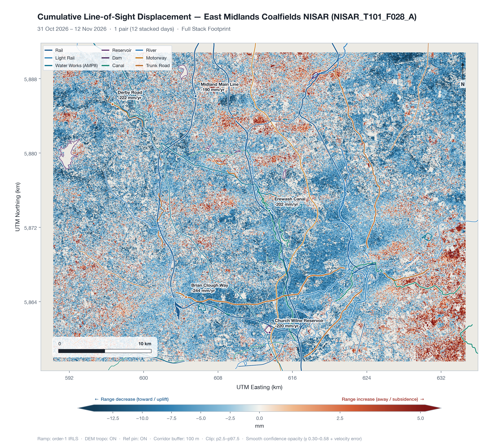
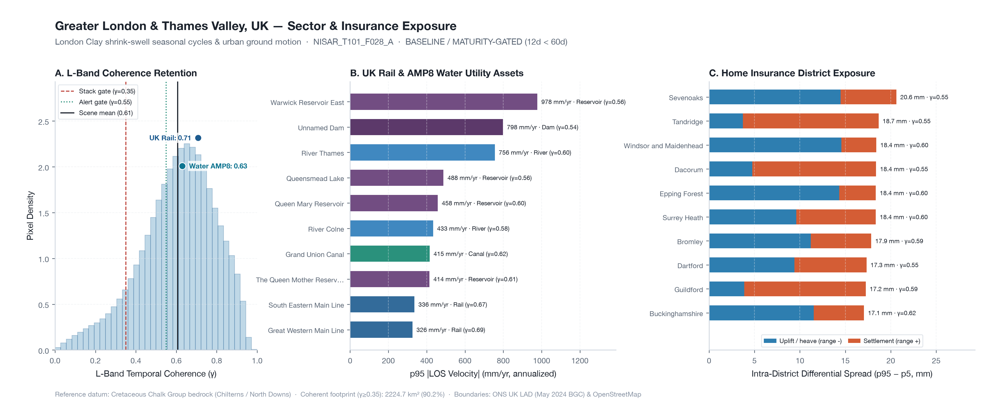
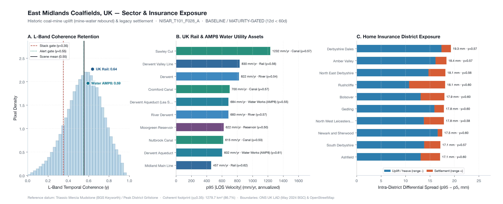
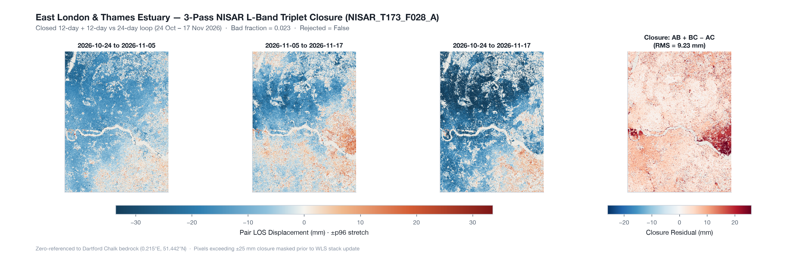
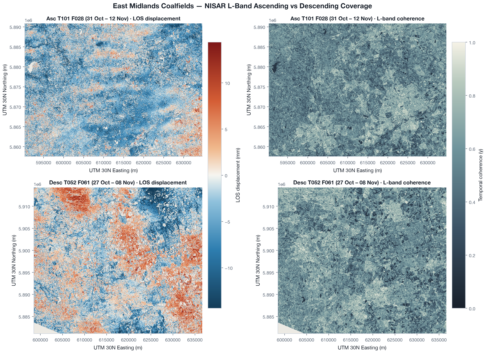

# insar-cpu-proto

Ground Stability & Structural Risk API

Native C++20 + OpenMP InSAR processing and sequential $O(1)$ time-series stacking engine for Sentinel-1 (OPERA CSLC-S1) and NISAR (L-band GSLC) radar imagery. Converts coregistered complex SLC pairs into calibrated millimeter-scale line-of-sight (LOS) deformation rasters, Cloud-Optimized GeoTIFFs, STAC 1.1.0 items, and SNR/maturity-gated linear infrastructure corridor risk alerts.

---

## Ground-Truth GNSS Validation — Mexico City (`T041_086877_IW1`)

<p align="center">
  
  
  
</p>

*Independent validation of a 24-pair Sentinel-1 OPERA CSLC-S1 stack (19 Jun – 17 Nov 2026, 145 stacked days) against 6 Nevada Geodetic Laboratory (UNR) North-America-fixed GNSS stations projected onto exact Sentinel-1 zero-Doppler LOS vectors (from OPERA ECEF orbit state vectors). Full per-station tables: [`data/validation/mexico_city_gnss_validation.json`](data/validation/mexico_city_gnss_validation.json) · [`mexico_city_gnss_validation.csv`](data/validation/mexico_city_gnss_validation.csv).*

| Pipeline Configuration | RMSE (mm/yr) | MAE (mm/yr) | Bias (mm/yr) | $R^2$ | Pearson $r$ | `MMX1` (2026 overlap, −215.0 mm/yr GNSS) |
| :--- | :---: | :---: | :---: | :---: | :---: | :---: |
| Baseline (whole-scene median, unmasked order-1 ramp, no DEM) | 64.0 | 42.5 | +37.8 | 0.321 | 0.883 | −70.3 mm/yr (err +144.7) |
| + Bedrock reference pin (`-99.215, 19.420`, $r = 1\text{ km}$, order-0) | 34.6 | 31.2 | −12.2 | 0.802 | 0.932 | −234.5 mm/yr (err −19.5) |
| **+ Copernicus GLO-30 DEM tropo + 2-pass deformation masking** | **18.3** | **15.1** | **−3.0** | **0.945** | **0.973** | **−213.3 mm/yr (err +1.7)** |

- **71.5% RMSE reduction** (64.0 → **18.3 mm/yr**) and **$R^2 = 0.945$** across all 6 independent stations (the bedrock reference pin in Lomas de Chapultepec is distinct from all validation stations).
- **Live 2026 cumulative overlay at `MMX1` (Mexico City Airport):** **7.7 mm** epoch-to-epoch RMSE across 25 Sentinel-1 passes against 142 daily UNR IGS20 GNSS observations tracking −85 mm of active clay-basin subsidence.

---

## Outputs

### Mexico City — Sentinel-1 C-Band Sequential Stack (`T041_086877_IW1`)


*24 consecutive OPERA CSLC-S1 pairs (19 Jun – 17 Nov 2026, 145 stacked days), connected-component bedrock reference pinning, two-pass adaptive high-deformation masking, Copernicus GLO-30 DEM tropospheric regression, DEM hillshade blended into velocity luminance, confidence-weighted opacity, and 100 m buffered Metro, Rail, and Motorway corridor overlays with $|v|/\sigma_v \ge 2.5$ SNR gating (suppressing false-positive critical alerts across incoherent mountain unwrapping boundaries while preserving true clay-basin alerts on Línea VK, Línea A, Línea B, and Circuito Interior).*

### West Yorkshire — NISAR L-Band (`NISAR_T052_F061_D`)

<p align="center">
  
</p>

*12-day L-band NISAR GSLC pair (27 Oct – 08 Nov 2026) over Huddersfield and the Holme Valley with buffered Canal, Rail, Motorway, River, Dam, and Reservoir corridors.*

### Single-Pair Diagnostics (`insar_proto`)


*Pair-level outputs for `NISAR_T052_F061_D_2026-10-27_2026-11-08`: wrapped interferometric phase $\psi \in [-\pi, \pi]$, spatial coherence $\gamma \in [0, 1]$, and unwrapped LOS displacement (mm) with high-coherence anomaly alerts.*

### Extended Stack Visualizations

Additional figures are generated from the checked-in stack, corridor, GNSS, DEM, and NISAR pair products:

| Figure | Contents |
| :--- | :--- |
| [`mexico_city_corridor_heatmap.png`](docs/figures/mexico_city_corridor_heatmap.png) | Corridor p95 absolute LOS velocity by acquisition date; label color shows the latest risk class. |
| [`mexico_city_stack_evolution.png`](docs/figures/mexico_city_stack_evolution.png) · [`mexico_city_stack_evolution.gif`](docs/figures/mexico_city_stack_evolution.gif) | Nine static snapshots plus a pass-by-pass animation synchronized to the selected GNSS station's LOS displacement series. |
| [`mexico_city_velocity_confidence.png`](docs/figures/mexico_city_velocity_confidence.png) | Significant LOS velocity, velocity SNR, and standard error. |
| [`mexico_city_velocity_gradient.png`](docs/figures/mexico_city_velocity_gradient.png) | Engineering view of LOS velocity gradients in mm/yr per 100 m with rail, metro, road, and water corridors. |
| [`mexico_city_velocity_hillshade.png`](docs/figures/mexico_city_velocity_hillshade.png) | Velocity with DEM relief blended into the luminance channel and confidence-weighted opacity. |
| [`mexico_city_basin_transect.png`](docs/figures/mexico_city_basin_transect.png) | Smoothed velocity, cumulative displacement, elevation, and coherence from the bedrock reference to MMX1. |
| [`mexico_city_gnss_residuals.png`](docs/figures/mexico_city_gnss_residuals.png) | Station residual map plus residual relationships with coherence and InSAR spatial spread. |
| [`west_yorkshire_nisar_track_comparison.png`](docs/figures/west_yorkshire_nisar_track_comparison.png) | T052 and T029 pair displacement and coherence in their respective LOS geometries. |



Regenerate the extended figures that use existing exports with:

```bash
python3 scripts/plots/plot_extended_visualizations.py
```

The stack evolution plot replays the stack into a temporary directory to capture corrected per-epoch rasters:

```bash
python3 scripts/plots/plot_stack_evolution.py
```

The replay reads settings from `stack_ledger.json`, writes the static panel and synchronized GIF by default, and leaves the existing stack outputs untouched. It uses the selected station's `.tenv3` file and LOS vector from the validation CSV; pass `--no-animation` to render only the static panel.

Install the optional scientific colormaps and GIF writer with:

```bash
python3 -m pip install -r deploy/requirements-plot.txt
```

The diverging maps fall back to the built-in palette if `cmcrameri` is unavailable. GIF export requires Pillow; use an `.mp4` output path when FFmpeg is installed.

---

## UK Test Sites — Greater London / Thames Valley & East Midlands Coalfields (NISAR L-Band GSLC)

Two UK civil-infrastructure testbeds built around live NASA Earthdata **`NISAR_L2_GSLC_V1`** streaming (`/vsicurl/` + Copernicus GLO-30 DEM + UNR Eurasia-fixed **`EU`** GNSS datum validation + ONS May 2024 Local Authority District rollups) for **UK rail**, **water utilities (AMP8)**, and **home insurance** stakeholders:

| Test Site & Track | Passes / Span | Datum & Geometry | Coherent Footprint ($\gamma \ge 0.35$) | UK Rail & AMP8 Water ($\gamma_w$) | ONS Insurance Zones |
| :--- | :--- | :--- | :--- | :--- | :--- |
| **Greater London & Thames Valley** (`NISAR_T101_F028_A`) | 2 passes · 12 d (`2026-10-31` – `2026-11-12`) | `AMER` Chalk (`[-0.5594, 51.6772]`) · Left Asc (`inc 40.79°`) | **2,224.66 km²** (`90.21%`) | Rail `24/24` (`0.7077`) · Water `33/33` (`0.6294`) | **57** fetched (`57` covered) |
| **London East Triplet** (`NISAR_T173_F028_A`) | 3 passes · 24 d (`2026-10-24` – `2026-11-17`) | Dartford Chalk (`[0.215, 51.442]`) · Left Asc (`inc 46.35°`) | **515.82 km²** (`80.13%`) · Closure RMS `9.23 mm` (`2.26%` bad) | Rail `12/24` (`0.6580`) · Water `8/33` (`0.5355`) | **18** covered |
| **East Midlands Coalfields** (`NISAR_T101_F028_A`) | 2 passes · 12 d (`2026-10-31` – `2026-11-12`) | `KEYW` Mercia Mudstone (`[-1.0781, 52.8790]`) · Left Asc (`inc 40.95°`) | **1,279.71 km²** (`86.68%`) | Rail `21/23` (`0.6370`) · Water `35/45` (`0.5917`) | **19** fetched (`15` covered) |
| **East Midlands Peak–Coal** (`NISAR_T052_F061_D`) | 2 passes · 12 d (`2026-10-27` – `2026-11-08`) | Ashover Gritstone (`[-1.500, 53.185]`) · Left Desc (`inc 44.14°`) | **1,102.05 km²** (`87.62%`) · DEM $r$: `-0.65 → -0.03` | Rail `8/23` (`0.6716`) · Water `19/45` (`0.6161`) | **12** covered |

- **Scientific Honesty & Stack Maturity Gating (`60 d` Gate):** Current operational NISAR archive availability over both UK sites spans `12`–`24` days, so every site accurately reports `stack_mature = false` (`12 d / 24 d < 60 d`) and downgrades annualized velocities to **provisional baseline diagnostics**. Matched **UNR `EU` GNSS** bedrock velocities (`16` stations in London including `AMER +0.4 ± 1.2`, `LICC +1.8 ± 0.9`, `STR3 +1.0 ± 1.2`, `TEDD +1.0 ± 0.9 mm/yr`; `4` stations in East Midlands including `KEYW +0.7 ± 0.9 mm/yr`, single-pair residual `+2.8 mm/yr` = `0.09 mm` over 12 days) confirm geodetic datum stability, while 12-day single-pair scatter (`spatial std ≈ 43–331 mm/yr`, i.e., `±1.4–10.9 mm`) illustrates why `min_alert_span_days = 60` gating is enforced before seasonal London Clay shrink-swell or mine-water rebound rates trigger infrastructure alerts.
- **L-Band Triplet Closure & DEM Tropospheric Mitigation:** With L-band triplet threshold `--closure-thresh-mm 25.0`, the 3-pass London East stack achieves `9.2282 mm` closure RMS (`0` rejected pairs). Across the Derbyshire/Nottinghamshire terrain step (`T052`), joint IRLS polynomial + Copernicus GLO-30 DEM tropospheric estimation drops frame RMS from `16.33 mm` to `6.19 mm` and suppresses elevation correlation (`r = -0.6455` $\to$ `-0.0346`).

<p align="center">
  
  
</p>

<p align="center">
  
</p>

<p align="center">
  
</p>

<p align="center">
  
  
</p>

### Interactive site reports

- [Mexico City · Sentinel-1 C-band](docs/interactive/mexico_city.html)
- [West Yorkshire · NISAR L-band](docs/interactive/west_yorkshire.html)

Each HTML embeds its stack COGs and feature data for building-scale zoom and corridor/station popups. The map libraries and basemap tiles are loaded from public CDNs.

---

## Architecture

| Component | Path | Role |
| :--- | :--- | :--- |
| **Shared C++ Core** | [`cpp/include/insar/`](cpp/include/insar) · [`cpp/src/`](cpp/src) · [`cpp/bindings/python_module.cpp`](cpp/bindings/python_module.cpp) | `libinsar` shared library with pairwise and stack APIs; nanobind runs the full applications in-process and exposes a zero-copy CPU NumPy/DLPack interferogram kernel |
| **Online Stacker** | [`cpp/src/stack/`](cpp/src/stack) · `insar_stack` | $O(1)$ per-pass updates to a 13-band Float64 sufficient-statistics raster (`stack_state.tif`), connected-component reference pinning, explicit/two-pass high-deformation masking, joint robust polynomial + DEM tropospheric regression (`--dem`), skip-1/skip-2 triplet phase closure masking & corrupted-pair rejection, velocity/uncertainty/SNR/acceleration COGs, and SNR + stack-maturity gated corridor risk analytics |
| **Platform Domain Services** | [`python/insar_platform/`](python/insar_platform) | Installable Python package organizing `domain/`, `providers/`, `pipelines/`, `publishing/`, `storage/`, `workflows/`, and compatibility `scripts/` CLI shims |
| **Control Plane** | [`python/insar_platform/api/`](python/insar_platform/api) | Modular FastAPI `app.py` and `routes/` for monitor/job/stack APIs, PostGIS spatial screening, STAC catalog, S3 range reads, API key checks, and transactional outbox enqueueing |
| **Compute Plane** | [`python/insar_platform/worker/`](python/insar_platform/worker) · [`python/insar_platform/workflows/`](python/insar_platform/workflows) | Celery workers execute typed ingestion, pairwise, and stack tasks; Redis-backed scheduling retries work after transient failures |
| **State & Artifacts** | [`python/insar_platform/storage/`](python/insar_platform/storage) · [`deploy/docker-compose.yml`](deploy/docker-compose.yml) | PostGIS is the system of record; MinIO/S3 stores artifact objects and checksums; SQLite/filesystem mode (`var/api_data/`) remains available for a standalone developer run |
| **DEM & GNSS Validation** | [`python/insar_platform/providers/`](python/insar_platform/providers) · [`python/insar_platform/pipelines/gnss_validation.py`](python/insar_platform/pipelines/gnss_validation.py) | Copernicus GLO-30 COG tile fetch/alignment and UNR/NGL GNSS LOS ground-truth validation (`--gnss-frame auto\|NA\|EU`, `--look-direction auto\|right\|left`) with exact zero-Doppler orbit projection and standalone map, scatter, and time-series figures |
| **UK Corridors & Sectors** | [`python/insar_platform/providers/osm_corridors.py`](python/insar_platform/providers/osm_corridors.py) · [`python/insar_platform/pipelines/uk_sectors.py`](python/insar_platform/pipelines/uk_sectors.py) | Overpass UK rail/AMP8 water/transport corridor presets (`london_thames`, `east_midlands_coalfields`), ONS May 2024 UK Local Authority District boundaries (`--zones-preset`), and sector/insurance rollups |
| **Cartography** | [`python/insar_platform/viz/`](python/insar_platform/viz) · [`scripts/plots/`](scripts/plots) | Standalone raster maps, UK sector dashboards, triplet closure & Asc/Desc track comparisons, corridor heatmaps, confidence diagnostics, GNSS residuals, transects, and replayed stack evolution panels |
| **Interactive Maps** | [`python/insar_platform/viz/interactive_map.py`](python/insar_platform/viz/interactive_map.py) · [`python/insar_platform/api/templates/job_preview.html`](python/insar_platform/api/templates/job_preview.html) | Embedded-COG reports with basemap toggle, opacity and swipe controls, clickable corridor/GNSS charts, and live job previews at `/preview/{job_id}` |
| **Operator CLI & SDK** | [`python/insar_platform/cli/insarctl.py`](python/insar_platform/cli/insarctl.py) · [`python/insar_platform/client/http.py`](python/insar_platform/client/http.py) · [`examples/sdk_demo.py`](examples/sdk_demo.py) | `insarctl` commands for Compose lifecycle, health and screening queries, monitor sync, and local workflows, plus `InsarClient` SDK and runnable demo |
| **Configs & Runtime State** | [`configs/sites.example.json`](configs/sites.example.json) · `var/` | Checked-in multi-site presets and gitignored local scratch/work directories (`var/work/`, `var/api_data/`, `var/out/`) |

---

## Quickstart

**Prerequisites:** CMake $\ge$ 3.18, a C++20 compiler (OpenMP optional), GDAL, and Python 3 (`fastapi`, `uvicorn`, `httpx`, `pydantic` for the API; `numpy`, `matplotlib`, and `osgeo` for plotting & GNSS validation).

### Local production-style stack

The Compose stack starts PostGIS, Redis, MinIO, the API, a C++ compute worker, and the outbox scheduler. Copy `.env.example` to `.env`, set local API and webhook secrets (and Earthdata credentials when required), then run:

```bash
cp .env.example .env
set -a; source .env; set +a
docker compose -f deploy/docker-compose.yml up -d --build
python3 -m pip install -e .
insarctl health
```

The `ingest` Python extra installs the ASF/Earthaccess clients for a local worker (`python3 -m pip install -e '.[ingest]'`). Raster-backed GNSS and DEM operations also need system GDAL Python bindings.

Register a monitor with its GeoJSON footprint and provider settings in `config`, then queue its daily idempotent discovery pass:

```bash
curl -X POST http://127.0.0.1:8000/v1/monitors \
  -H "X-API-Key: $INSAR_API_KEY" -H 'Content-Type: application/json' \
  -d '{"monitor_name":"site-a","geometry":{"type":"Point","coordinates":[-99.13,19.43]},"config":{"sensor":"opera","burst_id":"T041_086877_IW1","lookback_days":45,"max_granules":6,"stack":true}}'
insarctl sync-monitor site-a
```

The API stores the request and transactional outbox record in PostGIS; Celery dispatches it to the worker. Track progress at the returned `/v1/ingestions/{ingestion_id}` URL. `GET /v1/screen` data comes from PostGIS indexes, and result assets are served from MinIO with HTTP range support.

To import a legacy API database, keep its SQLite file available locally and run `insarctl migrate-sqlite /path/to/oem_jobs.db` with `INSAR_DATABASE_URL` pointing at the Compose PostGIS database. The import skips rows already present in Postgres.

API and worker containers keep only temporary working files. Put direct pair-job inputs in the configured S3/MinIO bucket and pass `s3://bucket/key` paths; the C++ worker reads those rasters through GDAL's S3 virtual filesystem. Ingestion workers stream provider inputs or download them into disposable scratch space, then publish pair and stack assets back to object storage.

To use the C++ binding in a local build, install `python3 -m pip install -e '.[native]'` in the selected Python environment and configure CMake with `-DINSAR_BUILD_PYTHON=ON`; the Compose worker image builds and installs this binding automatically. The ndarray interface accepts contiguous CPU arrays through DLPack (including NumPy and CPU PyTorch tensors); CUDA arrays are not supported by this CPU engine.

```bash
# Build C++ binaries (`insar_proto`, `insar_stack`) and run C++ + Python test suites
cmake -B build
cmake --build build -j
ctest --test-dir build --output-on-failure
python3 -m unittest discover -s tests -v
```

```bash
# 1. Run an interferometric pair with stable bedrock reference pinning -> COGs + alerts.geojson
./build/insar_proto \
  --slc1 ref.h5 --slc2 sec.h5 \
  --ref-lonlat -99.215 19.420 --ref-radius-m 1000 \
  --out-dir var/out/pair

# 2. Fetch and align Copernicus GLO-30 DEM to the InSAR stack grid
python3 scripts/fetch_dem.py \
  --ref-raster var/out/pair/displacement_mm.tif \
  --out var/work/dem/site_cop30.tif

# 3. Incrementally update a multi-pass stack (DEM tropo + reference pin + 2-pass deform mask
#    + automatic triplet closure when skip-1/skip-2 pairs exist + SNR/maturity corridor gating)
python3 scripts/stack_timeseries.py \
  --products-dir var/work/products/mexico_city_iw1 \
  --out-dir var/work/stacks/mexico_city_iw1 \
  --dem var/work/dem/mexico_city_iw1_cop30.tif \
  --ref-lonlat -99.215 19.420 --ref-radius-m 1000 \
  --ramp-order 0 --two-pass-deform-mask \
  --corridors data/corridors/mexico_city_corridors.geojson \
  --min-alert-snr 2.5 --min-alert-span-days 60

# 4. Validate against UNR/NGL GNSS stations and render standalone benchmark figures
python3 scripts/validate_gnss.py \
  --stack-dir var/work/stacks/mexico_city_iw1 \
  --products-dir var/work/products/mexico_city_iw1 \
  --dem var/work/dem/mexico_city_iw1_cop30.tif \
  --slc-h5 var/work/raw/mexico_city_iw1 \
  --out-json data/validation/mexico_city_gnss_validation.json \
  --map-out docs/figures/mexico_city_gnss_map.png \
  --scatter-out docs/figures/mexico_city_gnss_scatter.png \
  --timeseries-out docs/figures/mexico_city_gnss_timeseries.png

# 5. Render a standalone cartographic velocity map
python3 scripts/plots/plot_raster_map.py \
  --stack-dir var/work/stacks/mexico_city_iw1 \
  --layer velocity --focus-urban

# 6. Export standalone interactive maps (raster and vector payloads are embedded in each HTML)
python3 scripts/plots/export_interactive_map.py \
  --site-name "Mexico City · Sentinel-1 C-band" \
  --stack-dir var/work/stacks/mexico_city_iw1 \
  --corridors data/corridors/mexico_city_corridors.geojson \
  --gnss-json data/validation/mexico_city_gnss_validation.json \
  --output docs/interactive/mexico_city.html
python3 scripts/plots/export_interactive_map.py \
  --site-name "West Yorkshire · NISAR L-band" \
  --stack-dir var/work/stacks/west_yorkshire_t052 \
  --corridors data/corridors/west_yorkshire_corridors.geojson \
  --output docs/interactive/west_yorkshire.html

# 7. UK NISAR L-band test sites: fetch Overpass corridors + ONS LAD24 zones, stream/stack, roll up sectors & validate UNR EU GNSS
python3 scripts/fetch_corridors.py --preset london_thames --balance-classes --max-features 80 --out data/corridors/london_thames_corridors.geojson
python3 scripts/fetch_corridors.py --zones-preset london_thames --out data/zones/london_thames_zones.geojson
.venv/bin/python scripts/auto_ingest.py \
  --sites-config configs/sites.example.json \
  --site-id london_thames_nisar,london_east_nisar_t173,east_midlands_coalfields_nisar,east_midlands_coalfields_t052 \
  --continue-on-error
python3 scripts/uk_sector_analytics.py \
  --stack-dir var/work/stacks/london_thames_nisar \
  --profile london_thames \
  --zones data/zones/london_thames_zones.geojson \
  --out-json data/validation/london_thames_sector_report.json \
  --out-zones-csv data/validation/london_thames_insurance_zones.csv \
  --out-sectors-csv data/validation/london_thames_sectors.csv
python3 scripts/plots/plot_uk_sites.py dashboard \
  --report-json data/validation/london_thames_sector_report.json \
  --out docs/figures/london_thames_sector_dashboard.png
python3 scripts/validate_gnss.py \
  --stack-dir var/work/stacks/london_thames_nisar \
  --gnss-frame EU --look-direction left --incidence-deg 40.79 --heading-deg -22.426 \
  --out-json data/validation/london_thames_gnss_validation.json \
  --out-csv data/validation/london_thames_gnss_validation.csv
```

The reports provide satellite/dark basemap selection, raster opacity, a velocity/coherence swipe, clickable corridor displacement histories, and GNSS station charts where validation data are available. The HTML embeds the raster and feature payloads; Leaflet, Chart.js, and basemap tiles load from public CDNs.

### Unified OEM HTTP API & Docker

```bash
# Run locally (serves both /v1/jobs via insar_proto and /v1/stacks/{stack_id}/updates via insar_stack)
PYTHONPATH=python uvicorn insar_platform.api.app:app --host 0.0.0.0 --port 8000

# The API image is intended to run with the worker and durable services via Compose.
docker compose -f deploy/docker-compose.yml up -d --build
```

Key endpoints: `GET /health`, `GET /v1/admin/usage`, `POST /v1/monitors`, `POST /v1/monitors/{monitor_name}/sync`, `GET /v1/ingestions/{ingestion_id}`, `POST /v1/jobs`, `GET /v1/jobs/{job_id}`, `GET /preview/{job_id}`, `GET /stac/items/{job_id}`, `POST /v1/stacks/{stack_id}/updates`, `GET /v1/stacks`, `GET /v1/stacks/{stack_id}`, `GET /stac/stacks/{stack_id}`, `GET /assets/{job_id}/{file}`, and `GET /stack-assets/{stack_id}/{file}`. The `POST /v1/jobs` response includes a `preview_url` immediately, including while the job is queued.

---

<details>
<summary><strong>Method & Mathematical Summary</strong></summary>

1. **Interferogram & Coherence:** For coregistered SLCs $s_1, s_2$ over a $(2r_x+1)\times(2r_y+1)$ window $\mathcal{N}$, $C = \sum_{\mathcal{N}} s_1 s_2^*$, wrapped phase $\psi = \operatorname{atan2}(\operatorname{Im} C, \operatorname{Re} C)$, and coherence $\gamma = |C| / \big(\sqrt{\sum_{\mathcal{N}} |s_1|^2 \sum_{\mathcal{N}} |s_2|^2} + \varepsilon\big)$.
2. **Coherence-Weighted Unwrapping:** Minimizes $\frac{1}{2}\sum_e w_e (\nabla_e \phi - \mathcal{W}(\nabla_e \psi))^2$ with cubic edge weights $w_e = \max(10^{-4}, \min(\gamma_u, \gamma_v)^3)$ via Preconditioned Conjugate Gradient (PCG), preconditioned by an exact half-sample mirrored 2D radix-2 FFT Neumann Poisson solver.
3. **LOS Displacement & Reference Pinning:** $d_{\text{LOS}} = \frac{\lambda}{4\pi}\phi$ ($\lambda = 55.4658\text{ mm}$ for Sentinel-1 C-band; dynamic HDF5 wavelength $\approx 238.4\text{ mm}$ for NISAR L-band), zero-referenced to the coherence-weighted median of a user-specified stable reference disk (`--ref-lonlat` / `--ref-px`) or GeoJSON/raster mask (`--ref-region`) rather than the whole-scene median.
4. **Connected-Component Isolation, High-Deformation Masking & DEM Tropospheric Correction:** Before fitting orbital/tropospheric nuisance terms, `insar_stack` restricts regression to the 4-connected coherent component anchored at the reference region (preventing cross-barrier $2\pi$ unwrapping jumps from leaking into regression) and masks active deformation zones via explicit polygons/rasters (`--deform-mask`), prior velocity (`--prior-vel` / `--two-pass-deform-mask`), and adaptive quantile capping. It jointly solves for a polynomial ramp plus ridge-damped elevation-correlated tropospheric delay $d_{\text{nuisance}}(x,y,z) = p_k(x,y) + \alpha\,\Delta z_{\text{km}}$ via Huber/Tukey IRLS, then re-pins the reference region to $0\text{ mm}$.
5. **Redundant Skip-1/Skip-2 Triplet Phase Closure:** When skip-1/skip-2 interferograms are available (`--max-skip 1|2`), `stack_timeseries.py` automatically supplies triangle loops to `insar_stack` to evaluate closure residuals $c = d_{AB} + d_{BC} - d_{AC}$ (datum-centered). Pixels exceeding `--closure-thresh-mm` (default $10\text{ mm}$) across a majority of triplets are masked before state updates, and pairs exceeding `--closure-max-bad-frac` (default $35\%$) are rejected cleanly before mutating `stack_state.tif`.
6. **Sequential $O(1)$ Stacking & SNR/Maturity-Gated Corridor Alerts:** Each accepted interferogram updates a persistent 13-band Float64 normal-equation state (`stack_state.tif`) in constant time per pass, producing exact WLS velocity $v$, standard error $\sigma_v$, signal-to-noise ratio $\text{SNR} = |v|/\sigma_v$ (`velocity_snr.tif`), acceleration, cumulative displacement, and temporal coherence. Critical corridor alerts require both sufficient velocity SNR ($|v|/\sigma_v \ge 2.5$) and minimum stack temporal maturity ($\ge 60\text{–}90\text{ days}$); immature stacks downgrade critical alerts to provisional warnings.

</details>
